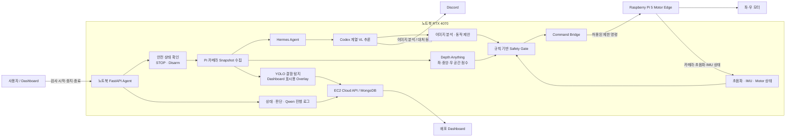
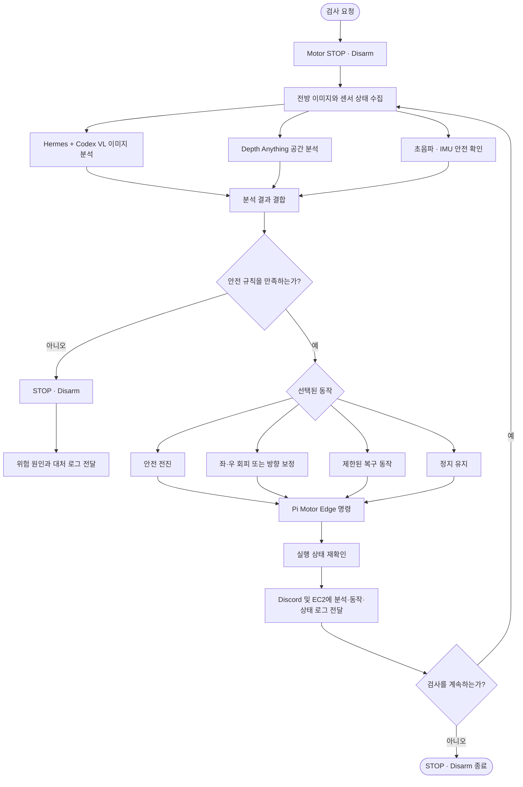

# AI

탐사 로봇 프로젝트의 AI 모듈 모음입니다. 결함 탐지 → 3D 재구성 → 보고서 생성으로 이어지는 파이프라인을 구성합니다.

| 모듈 | 사용 모델/기법 | 입력 | 출력 | 상태 |
|---|---|---|---|---|
| [AIAgent](./AIAgent/) | Hermes Agent + Codex 계열 VL, Depth Anything, 안전 규칙 엔진 | Pi 카메라·초음파·IMU | 로봇 동작 명령, 상태·판단 로그, Dashboard telemetry | ✅ 통합 동작 |
| [yolo_detection](./yolo_detection/) | YOLO11n / YOLO11n-seg (+ SAM 2.1 pseudo-labeling) | 관로 내부 CCTV 이미지 | 결함(균열) bbox·세그멘테이션 마스크, 학습 가중치 | ✅ 학습 완료 |
| [3d_gsplat](./3d_gsplat/) | 3D Gaussian Splatting (gsplat) | 다시점 촬영 이미지 (COLMAP) | 3D splat(PLY), 렌더링 이미지·플라이스루 영상 | ✅ 학습 검증 완료 |
| [llm_report](./llm_report/) | LLM 요약 + PDF 렌더링 | 탐사 세션 결함 데이터 | PDF 탐사 보고서 | 🚧 설계 단계 |

## 1. AIAgent — Hermes + Codex VL 로봇 제어

PipeCheckkk AI Agent는 하수관 내부의 전방 이미지를 분석하고 센서 상태를 함께 확인하여, 로봇이 취할 다음 동작을 결정하는 노트북 기반 제어 Agent입니다.

VL 판단은 **Hermes Agent와 Codex 계열 추론 모델의 조합**으로 수행합니다. 카메라 이미지에서 관로 상태와 진행 가능 방향을 해석하고, 그 결과를 정해진 안전·주행 규칙과 대조한 뒤 허용된 동작만 Raspberry Pi Motor Edge에 전달합니다.

> 핵심 원칙: **이미지를 보고 상황을 판단하되, 실제 구동은 반드시 정해진 규칙의 범위 안에서만 수행합니다.**

### 주요 역할

- Raspberry Pi 전방 카메라 이미지 수집
- Hermes + Codex VL을 이용한 이미지 분석 및 상황 판단
- Depth Anything 기반 좌·중앙·우 공간 점수 확인
- 초음파 거리와 IMU 자세값을 이용한 안전 검증
- 규칙 기반 주행·회피·정지 동작 선택
- Raspberry Pi Motor Edge로 제한된 모터 명령 전달
- Discord에 VL 분석 결과와 결정 동작 전달
- EC2 Cloud API로 상태, 로그, Qwen 진행 요약, 최신 영상 전송
- Dashboard에서 Agent 상태와 탐지 결과 표시

### VL 분석 결과 형식

VL 분석 결과는 Discord에 다음 형식으로 전달합니다.

```text
이미지 분석 : 전방 관로 상태, 장애물, 결함 후보, 진행 가능 방향에 대한 설명
대처 동작 : 안전 규칙을 적용한 다음 동작과 그 이유
```

Agent는 이미지 분석 내용만으로 모터를 자유롭게 움직이지 않습니다. VL이 제안한 방향을 초음파, IMU, 공간 점수, 현재 제어 상태와 대조하고 규칙상 허용되는 경우에만 실제 명령으로 변환합니다.

### 시스템 구조도



### 동작 순서

1. 사용자가 우선순위 화면에서 검사 구역과 로봇, 작업자를 선택합니다.
2. Dashboard가 Cloud 검사 세션을 생성하고 Local Agent에 검사 시작을 요청합니다.
3. Local Agent는 VL 분석 전에 Motor Edge를 `STOP` 및 `Disarm` 상태로 만들어 안전을 확보합니다.
4. Raspberry Pi 카메라에서 실제 전방 이미지를 가져오고 초음파·IMU·Motor 상태를 확인합니다.
5. Hermes가 이미지와 센서 상태를 Codex 계열 VL 추론에 전달합니다.
6. VL은 관로 상태, 장애물, 결함 후보, 진행 가능한 방향을 이미지에서 판단합니다.
7. Agent가 VL 제안과 Depth Anything 공간 점수, 초음파 거리, IMU 자세값을 규칙 엔진에서 함께 검증합니다.
8. 규칙을 통과한 동작만 Command Bridge를 통해 Raspberry Pi Motor Edge로 전달합니다.
9. Agent는 Discord에 `이미지 분석`과 `대처 동작`을 알리고, Cloud API에는 상태·판단 로그·최신 영상을 전송합니다.
10. Dashboard는 EC2 API와 MongoDB에 저장된 최신 상태와 탐지 결과를 계속 표시합니다.
11. 검사 중지 또는 종료가 요청되면 즉시 모터를 정지하고 Disarm 상태로 인계합니다.

### 판단 순서도



### 규칙 기반 안전 판단

VL은 주변 상황을 이해하고 다음 행동을 제안하지만, 아래 규칙은 VL 판단보다 우선합니다.

- Motor Edge가 없거나 응답하지 않으면 실제 주행을 시작하지 않습니다.
- 정상 전진 중 초음파 거리가 안전 한계 이하이면 즉시 정지합니다.
- IMU의 pitch·roll이 허용 범위를 벗어나면 정지하고 위험 상태를 보고합니다.
- 방향 전환은 정해진 출력 상한과 종료 조건 안에서만 수행합니다.
- 후진은 시각 정체를 벗어나기 위한 짧고 제한된 복구 동작으로만 허용합니다.
- 이미지 또는 센서 상태를 신뢰할 수 없으면 추측해서 주행하지 않고 `STOP`을 선택합니다.
- 각 동작이 끝나면 현재 상태를 다시 확인하고, 완료 또는 오류 시 `STOP` 및 `Disarm`으로 인계합니다.

따라서 최종 동작은 다음 관계로 결정됩니다.

```text
최종 동작 = VL 이미지 판단 + 공간 인식 + 센서 검증 + 규칙 기반 Safety Gate
```

### 모델별 역할

| 구성 요소 | 역할 |
|---|---|
| Hermes Agent | 이미지·센서 문맥 전달, VL 실행 조정, Discord 결과 전달 |
| Codex 계열 추론 모델 | 실제 이미지 이해, 위험 요소 및 진행 방향 판단, 대처 동작 제안 |
| Depth Anything | 좌·중앙·우 공간의 상대적인 진행 가능성 계산 |
| YOLO | 결함 후보 탐지와 Dashboard용 시각화 Overlay 생성 |
| Qwen | 검사 진행 상황을 짧게 요약하는 상태 안내 전용 |
| 규칙 엔진 | 초음파·IMU·Motor 상태와 동작 제한을 검증하는 최종 Safety Gate |

### 로그와 Dashboard

Agent는 판단 과정을 숨기지 않고 다음 정보를 외부에 전달합니다.

- Hermes VL 실행 상태
- 이미지에서 확인한 상황
- 선택한 대처 동작과 이유
- Local Agent의 미션 및 주행 상태
- Qwen 진행 요약
- 최신 YOLO 탐지 Overlay 영상
- 정지, 완료, 오류, 안전 차단 이벤트

웹 화면은 로봇을 EC2에서 직접 제어하지 않습니다. 영상과 상태·로그는 EC2를 통해 표시하지만, 실제 모터 명령은 항상 다음 로컬 경로를 사용합니다.

```text
Dashboard → Local Agent → Raspberry Pi Motor Edge → Motor
```

EC2 Cloud API와 MongoDB는 상태·로그·탐지 결과의 표시 및 저장 역할만 담당합니다.

### 종료 원칙

검사 중지, 검사 종료, 통신 오류, 센서 오류 또는 안전 규칙 위반이 발생하면 Agent는 가능한 경우 즉시 다음 상태로 전환합니다.

```text
Motor STOP → Disarm → 상태 확인 → 로그 전달
```

이 원칙을 통해 VL의 유연한 이미지 판단과 규칙 기반 제어의 예측 가능성을 함께 유지합니다.

## 2. yolo_detection — 결함 탐지

하수관로 내부 이미지 2,000장(COCO 포맷, 클래스: `EX`, `CL` 종방향 균열)으로 **YOLO11n**을 파인튜닝했습니다. 세그멘테이션은 **SAM 2.1**로 bbox에서 pseudo-label을 생성해 **YOLO11n-seg**를 학습했습니다.

- Detection 성능: mAP50 **0.321**, mAP50-95 0.182, Precision 0.826 / Recall 0.313
- Segmentation(Mask) 성능: mAP50 **0.261**, mAP50-95 0.122
- Precision은 높고 Recall이 낮은 상태 — 클래스 불균형(CL 2,827 vs EX 41)이 주 원인
- 산출물: `models/detect|segment/*_best.pt` 배포 가중치, `runs/`의 지표·시각화

## 3. 3d_gsplat — 탐사 현장 3D 재구성

[nerfstudio gsplat](https://github.com/nerfstudio-project/gsplat) 기반 **3D Gaussian Splatting**으로 다시점 이미지에서 현장을 3D 재구성합니다.

- 입력: COLMAP 워크스페이스(이미지 + 카메라 포즈)
- 출력: splat PLY(웹 뷰어 연동용), 렌더링 이미지, 카메라 궤적 영상(mp4)
- 검증 결과(garden 씬, 30k steps): PSNR **24.16** / SSIM 0.906 / LPIPS 0.326, 86만 가우시안, ~0.006 s/frame 실시간 렌더링
- 3DGS 기법 리서치 노트: [3d_gsplat/RESEARCH.md](./3d_gsplat/RESEARCH.md)

## 4. llm_report — 탐사 보고서 자동 생성 (예정)

탐사 완료 후 세션의 결함 데이터(유형·심각도·이미지)를 LLM으로 요약해 **PDF 형식의 점검 보고서**를 생성하는 모듈입니다. 현재 백엔드의 단순 문자열 요약을 서술형 상태 평가·조치 권고로 고도화하는 것이 목표입니다. 상세 설계는 [llm_report/README.md](./llm_report/README.md) 참고.

## 전체 파이프라인

```
로봇 탐사 (이미지 수집)
   ├──▶ AIAgent        : Hermes + Codex VL 판단 → 안전 규칙 검증 → Pi 직접 제어·로그 전송
   ├──▶ yolo_detection : 결함 탐지 → 결함 이미지·메타데이터 업로드 (Cloud API)
   ├──▶ 3d_gsplat      : 다시점 이미지 → 3D 재구성 (웹 뷰어 시각화)
   └──▶ llm_report     : 탐사 종료 후 결함 데이터 요약 → PDF 보고서
```
